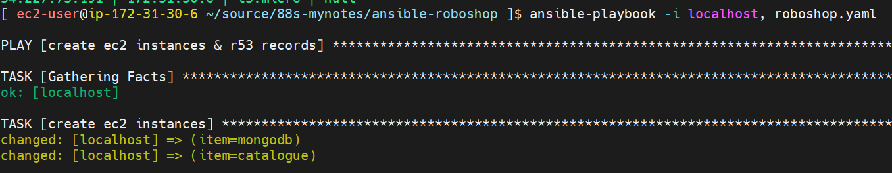
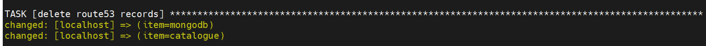
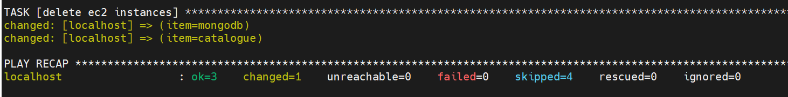
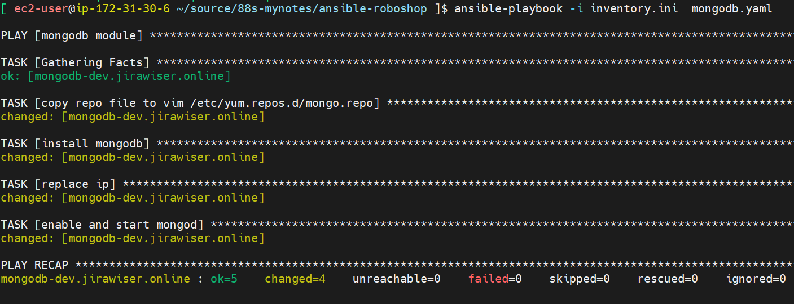
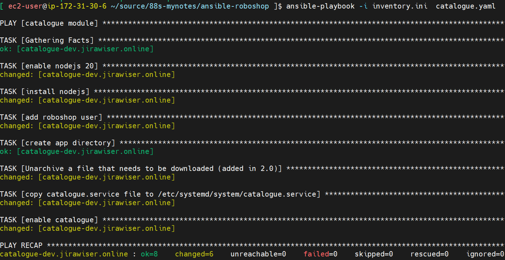

## setup control node (ansible + inventory)
### on control node
`dnf install ansible -y`

Install dependencies for aws
`pip install botocore boto3`
### inventory.ini
Logically organized list of managed nodes 

### setup managed nodes with roboshop.yaml
`ansible-playbook -i localhost, roboshop.yaml`

### output

### delete rout53 records & ec2-instances when action=delete
`ansible-playbook -i localhost, roboshop.yaml -e "action=delete"`
roboshop.yaml

### install mongodb
mongodb.yaml

### output

### install catalogue
catalgoue.yaml

## error when aws nameservers weren't updated in the domain. Update nameservers to fix the following error.  
### Switch nameservers to aws DNS must be managed by AWS
fatal: [mongodb-dev.jirawiser.online]: UNREACHABLE! => {"changed": false, "msg": "Failed to connect to the host via ssh: Warning: Permanently added 'mongodb-dev.jirawiser.online' (ECDSA) to the list of known hosts.\r\nec2-user@mongodb-dev.jirawiser.online: Permission denied (publickey,gssapi-keyex,gssapi-with-mic,password).", "unreachable": true}

