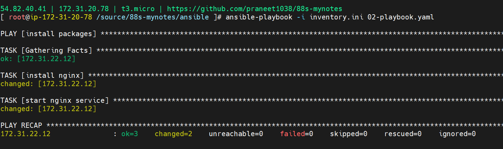

Here are some common use cases for Ansible:

Eliminate repetition and simplify workflows

Manage and maintain system configuration

Continuously deploy complex software

Perform zero-downtime rolling updates

Ansible uses simple, human-readable scripts called playbooks to automate your tasks. You declare the desired state of a local or remote system in your playbook. Ansible ensures that the system remains in that state.

As automation technology, Ansible is designed around the following principles:

Agent-less architecture
Low maintenance overhead by avoiding the installation of additional software across IT infrastructure.

Simplicity
Automation playbooks use straightforward YAML syntax for code that reads like documentation. Ansible is also decentralized, using SSH with existing OS credentials to access remote machines.

Scalability and flexibility
Easily and quickly scale the systems you automate through a modular design that supports a large range of operating systems, cloud platforms, and network devices.

Idempotence and predictability
When the system is in the state your playbook describes, Ansible does not change anything, even if the playbook runs multiple times.

SetUp

### Controller
`dnf install ansible -y`
### command to list hosts under frontend
`ansible frontend -i inventory.ini  --list-hosts`
`ansible roboshop -i inventory.ini  --list-hosts`
`ansible ungrouped -i inventory.ini  --list-hosts`
`ansible-inventory -i inventory.ini --graph`
## playbook
builtin modules & community modules

### commands to run playbooks
`ansible-playbook -i inventory.ini 10-playbook.yaml`

Note: above command executed as root installs nginx without requiring user credentials. 

### shell vs command module differences

### declaring variables 
- Argument variables
- Task level variables 
- vars_file
- Prompt variables
- Play level variables 
- Inventory

### datatypes
- string
- number
- list
- dict
- map

### loops

### conditions

### Builtin functions
- print message
- split string to list
- map to list
- list to map
- read file 
- json to yaml 
- yaml to json
- filters

### error handling

