### add status check for all scripts to verify successul service implementation
echo systemctl status servicename
echo netstat -lntp | grep service/package name

### mongodb output
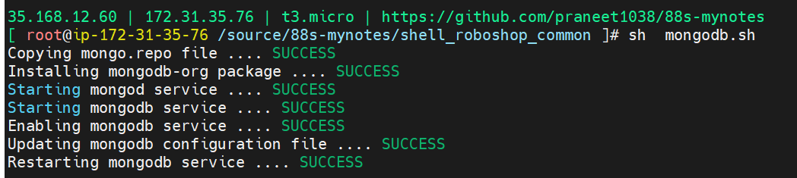

### catalogue output
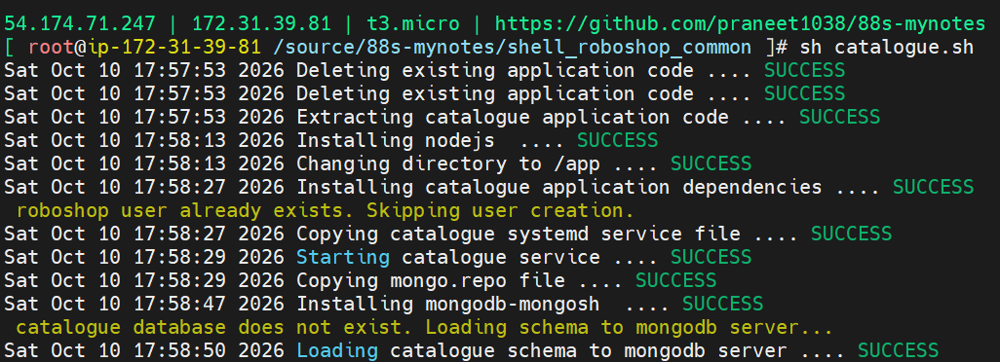

### redis output
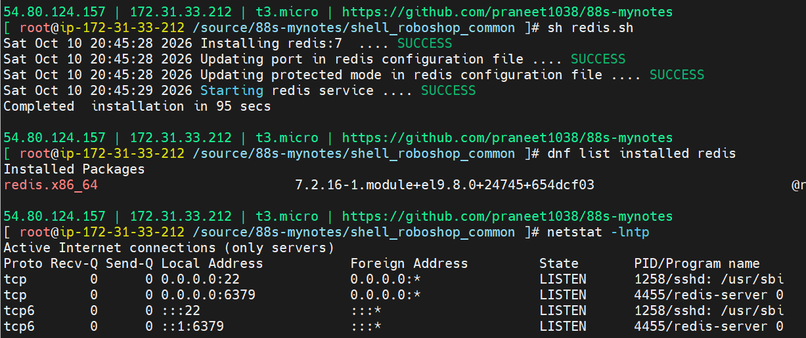
### user output
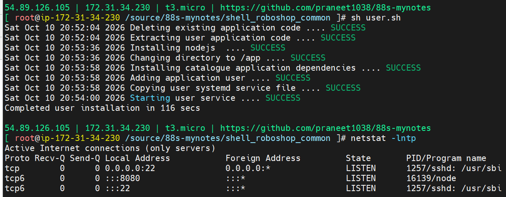
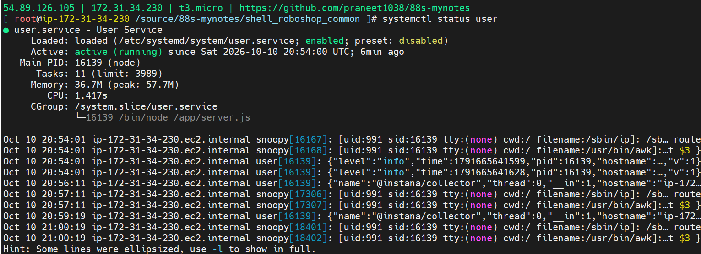
### cart output
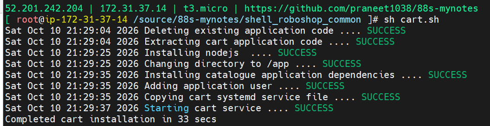
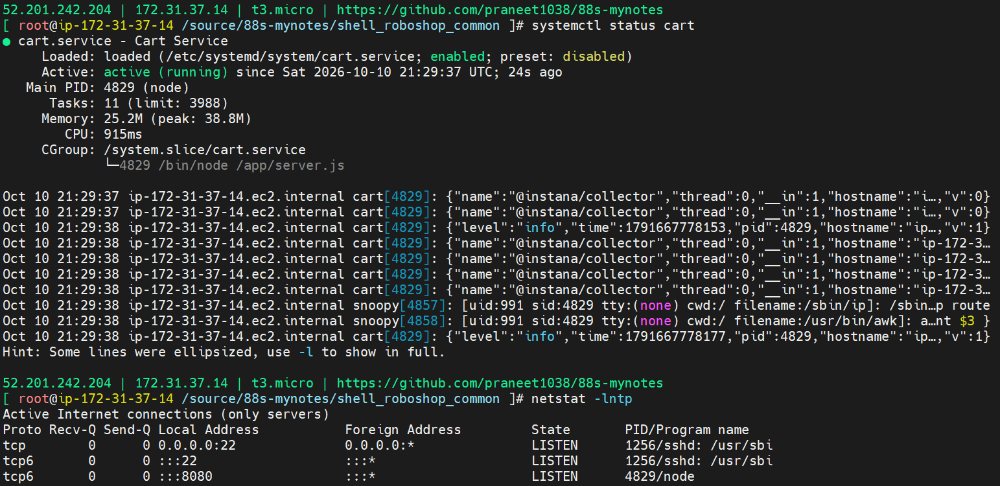
### payment
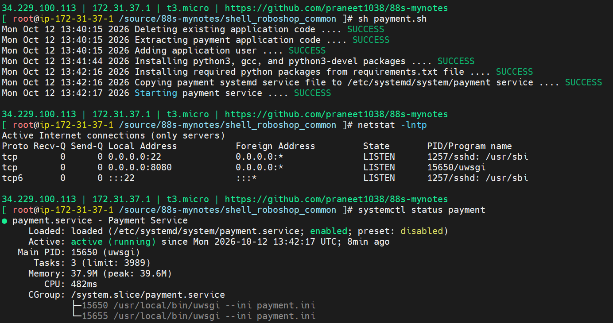
### rabbitmq
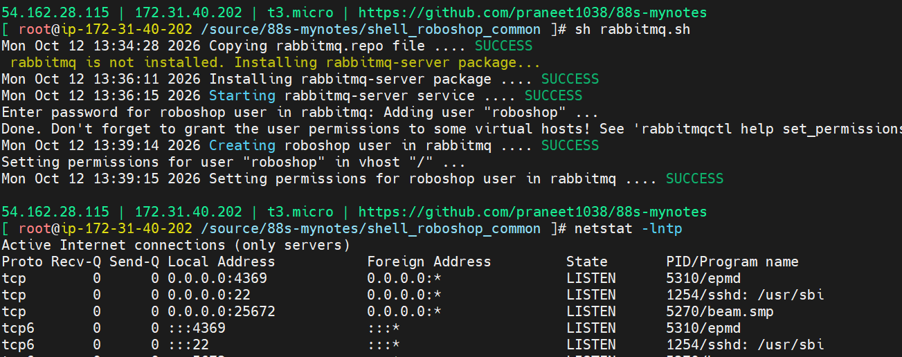

### mysql output
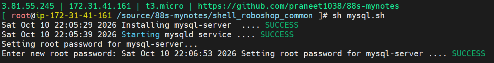
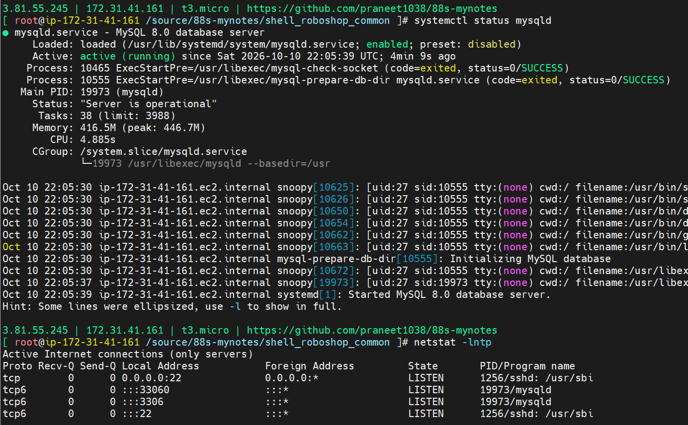
### shipping output
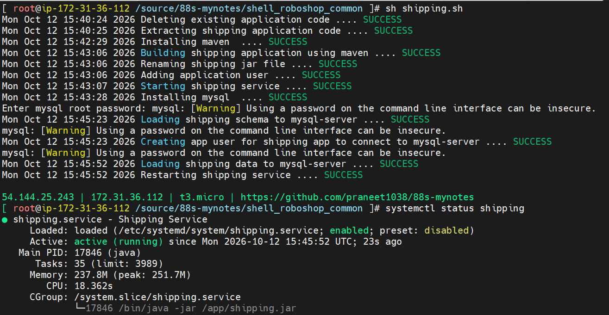

### frontend output
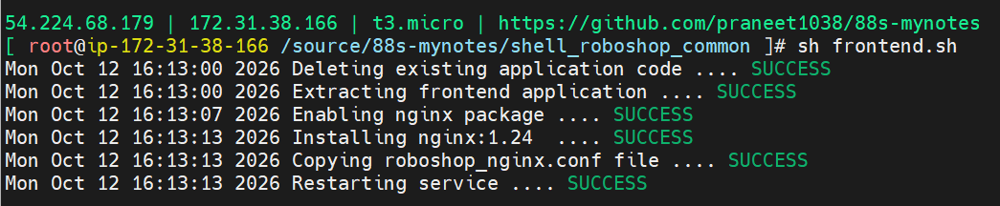
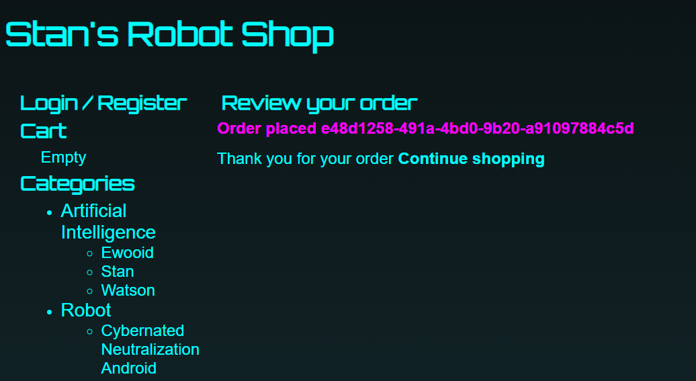

### dispatch output
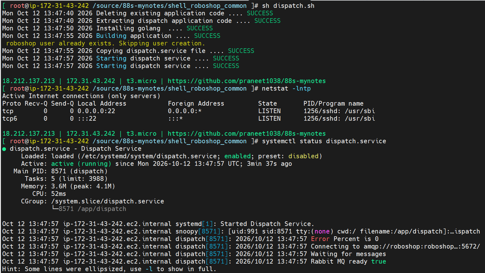
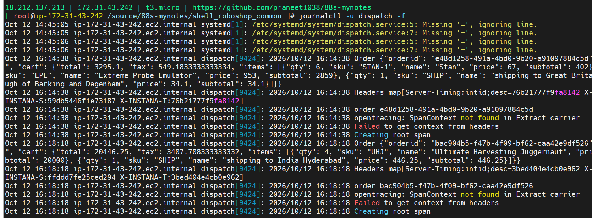
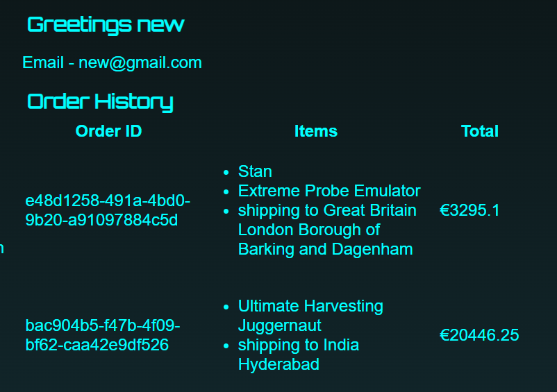